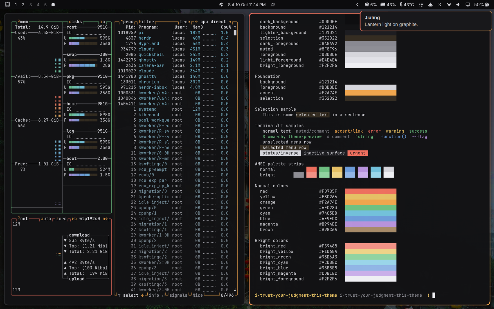

# Jialing

Lantern light on graphite. A dark Omarchy theme with cool, neutral surfaces and one warm accent: the amber of Hongyadong's lanterns, with an ember red at the start of the focused window's outline. Everything else stays quiet so the amber is the only thing that glows.



What you get:

- A red-to-amber outline on the focused window with a faint warm glow; other windows sit behind a neutral hairline and a soft neutral shadow.
- Squircle corners, a little more air between windows, and a shell whose cards sit on a raised graphite surface under a 10 % white hairline. Amber appears only where something is focused, selected, or counting down.
- A lantern edge on notifications and on the chosen launcher and menu row: the focus gradient as a hairline, thicker down the left. The lock screen's password field is borderless at rest and lights up with the gradient while you type.
- Instant windows, soft light: windows open, close, and move without animation, while borders, popups, and fades cross-fade in about 150 ms.
- A graphite wallpaper with a lantern glow, Yaru-yellow icons, a softened terminal palette with a steel-blue ANSI blue for the river, and matching Herdr colours.

## Standard Omarchy install

On Omarchy 4:

```bash
omarchy theme install https://github.com/lucasscariot/omarchy-jialing.git
```

Omarchy reads the palette, the shell surfaces, the wallpaper, and the icon theme from this repository and generates terminal, editor, and Hyprland config from its current templates. The focus gradient and the neutral inactive outline follow the palette; border width, corner radius, shadows, and animations follow Omarchy's defaults. This path does not install the optional Herdr hook.

## Full local appearance

To include Jialing's window chrome (2 px focus outline, 10 px squircle corners, soft shadows, instant windows with soft fades) and the optional Herdr colours, use the local installer:

```bash
curl -fsSL https://raw.githubusercontent.com/lucasscariot/omarchy-jialing/main/install.sh | bash
```

The installer copies the theme into `~/.config/omarchy/themes/jialing`, backs up any files it replaces, and selects Jialing. It needs Git and Python 3.11+. The backup path is printed before the theme is applied. Re-run the command to update the theme. Use either install method for a given theme directory; the local installer does not modify a Git clone created by `omarchy theme install`.

To inspect or run the installer locally:

```bash
git clone https://github.com/lucasscariot/omarchy-jialing.git
cd omarchy-jialing
python3 install.py
```

`python3 install.py --no-apply` installs the files without changing the current desktop theme. Switch later with `omarchy theme set jialing`.

The package contains one dark theme: `colors.toml`, `shell.toml`, `icons.theme`, a wallpaper in `backgrounds/`, a selector preview, and optional local appearance files. Omarchy generates Ghostty's colors from `colors.toml`. Wallpapers you keep in the theme's `backgrounds/` directory or in `~/.config/omarchy/backgrounds/jialing/` stay available beside the shipped one; select them through Omarchy.

Ghostty padding is a personal terminal setting. To keep the previous Jialing spacing with either install method, add this to `~/.config/ghostty/config`:

```ini
window-padding-x = 14
window-padding-y = 14
```

Jialing also contains optional Herdr colours in `herdr.toml`: a darker sidebar, and the focus outline's amber and red as Herdr's accent and alert colours, so the active tab matches the focused window. The installed Omarchy `theme-set` hook applies them to Herdr when Jialing is selected and removes them when another theme is selected, preserving the rest of your Herdr settings. If Herdr is not installed, the hook does nothing.

## Restore

Use the backup path printed by the installer:

```bash
python3 install.py --restore /path/to/backup
```

Restore checks for edits made after installation before changing any files. If Jialing is active, select another theme first so the Herdr hook removes its colours. The installer does not modify packaged files under `/usr/share/omarchy/`.

## Development

```bash
python3 -m unittest discover -s tests -v
bash -n install.sh
```

The tests check the installer, the Herdr hook, the palette's contrast, and that the focus gradient and accent are the same in `colors.toml`, `shell.toml`, `hyprland.lua`, and `herdr.toml`. See [REVIEW.md](REVIEW.md) for the manual desktop check. Code and theme configuration are MIT licensed; Omarchy-derived shell configuration retains the upstream copyright in [LICENSE](LICENSE).
